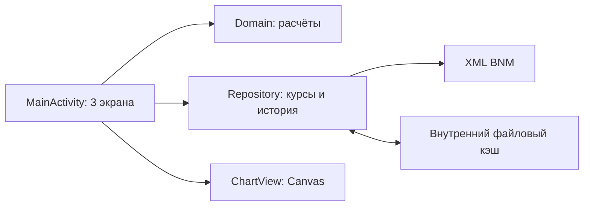

# 📱 Курс Mobile · Android-конвертер BNM

**Лабораторная PSI №4.** Нативное Android-приложение на Kotlin: конвертация валют и аналитика выбранной пары за **7 и 30 дней**.


[Установка](#запуск-без-сборки) · [Использование](#как-пользоваться) · [Сборка](#сборка-из-исходников) · [Тесты](#тестирование) · [Отчёт](REPORT.md)

## Возможности

| Экран | Что показывает |
|---|---|
| Конвертер | Сумма, валютная пара, результат, источник и дата курса |
| 7 дней | График и статистика за неделю |
| 30 дней | График и статистика за месяц |

На экранах аналитики: минимум, максимум, среднее, абсолютное и процентное изменение, направление тенденции. Отображаются число доступных дней, актуальность и использование кэша.

Данные получаются из BNM и сохраняются внутри приложения. Сетевой сбой обрабатывается сообщением; сохранённые данные переживают закрытие и повторный запуск.

## Стек

| Компонент | Технология |
|---|---|
| Язык | Kotlin 2.1.21 |
| Интерфейс | Нативные Android Views, Activity, ScrollView, LinearLayout |
| График | Собственный View с Android Canvas |
| Расчёты | BigDecimal, java.time |
| Сеть | HttpURLConnection, XML BNM |
| Хранение | XML-файлы во внутреннем каталоге приложения |
| Тесты | JUnit 4.13.2 |
| Сборка | Gradle 8.11.1, Android Gradle Plugin 8.9.2 |
| Java | JDK 21 в контейнере; целевой байткод Java/Kotlin 17 |
| Android | compile/target SDK 35, min SDK 26 — Android 8.0+ |
| Окружение | Docker Compose, Android Studio / Android Emulator, GitHub Actions |

Это Kotlin-приложение с собственным UI. Код №3 (Python и браузерный JavaScript) сюда не копировался и автоматически не переводился.

## Запуск без сборки

Готовый debug APK доступен в [релизе v0.1.0](https://github.com/aristique/ai-currency-android/releases/tag/v0.1.0). Также APK создаётся в `artifacts/lab4-currency-debug.apk` после локальной сборки и прикладывается к результатам GitHub Actions.

### На Windows без Android-телефона

1. Установите Android Studio и компоненты Android Emulator / SDK.
2. Откройте **Device Manager**, создайте виртуальное устройство с Android 8.0+ (для воспроизведения сборочного окружения можно выбрать API 35).
3. Запустите эмулятор кнопкой ▶.
4. Перетащите скачанный APK в окно эмулятора.
5. Откройте **«Курс Mobile»** в списке приложений.

**Физический телефон не нужен:** задание разрешает живую демонстрацию в эмуляторе. Docker не требуется для работы установленного APK.

Установка через ADB из PowerShell, если SDK находится в стандартной папке:

```powershell
$adb = "$env:LOCALAPPDATA/Android/Sdk/platform-tools/adb.exe"
& $adb devices
& $adb install -r ./artifacts/lab4-currency-debug.apk
& $adb shell am start -n md.lab.currency/.MainActivity
```

Команды предполагают одно подключённое устройство; при нескольких укажите `-s SERIAL`.

## Как пользоваться

1. При первом запуске дождитесь получения курса с интернетом.
2. Введите положительную сумму, выберите исходную и целевую валюты.
3. Нажмите **«Конвертировать»**.
4. Откройте **«7 дней»** или **«30 дней»** для выбранной валютной пары.
5. Прокрутите экран вниз, чтобы увидеть все показатели статистики.

Месячная история при первой загрузке может потребовать до 30 запросов. Нажмите **«Загрузить недостающие дни»**, если источник был недоступен. Отсутствующие наблюдения не заменяются выдуманными значениями: полнота периода отображается явно.

## Кэш и офлайн-демонстрация

Файлы находятся во внутреннем каталоге приложения: `files/bnm-rates/YYYY-MM-DD.xml`. Доступ к ним не требует отдельного пользовательского Excel/Word-файла.

Перед защитой загрузите курс и оба периода с интернетом. Затем включите режим полёта **в эмуляторе**, принудительно остановите приложение и откройте снова. Оно должно показать дату сохранённого курса и доступную историю. После проверки верните сеть.

Удаление приложения очищает кэш. Остановка Docker-контейнера сборки на данные установленного приложения не влияет.

## Сборка из исходников

Нужен Docker с работающим Linux-движком. Первый запуск требует интернета для SDK и Gradle-зависимостей.

```powershell
git clone https://github.com/aristique/ai-currency-android.git
cd ai-currency-android
docker compose run --build --rm android-build
```

Сборка выполняет unit-тесты, `assembleDebug` и `lintDebug`, затем сохраняет APK и отчёты в `artifacts`. Локально устанавливать JDK/Gradle/SDK для этого способа не нужно.

Gradle-кэш и debug-ключ находятся в именованных Docker volumes. Сохраняйте их между сборками. При другом ключе повторная установка поверх старого приложения может быть отклонена Android.

## Тестирование

```powershell
docker compose run --build --rm tests
```

| Файл | Покрытие |
|---|---|
| [DomainTest.kt](app/src/test/java/md/lab/currency/DomainTest.kt) | XML, номинал, ввод, конвертация, статистика и пустые данные |
| [RepositoryTest.kt](app/src/test/java/md/lab/currency/RepositoryTest.kt) | Получение курса, повреждённый кэш, история и чтение без сети |

**Проверено в Linux Docker:** 14 JUnit-тестов, сборка APK и Android Lint без ошибок. Это локальные JVM unit-тесты; Espresso/Appium UI-набора пока нет.

**Живая проверка Windows, 28.10.2026:** APK установлен в эмулятор Pixel 8; получен реальный курс BNM, выполнена конвертация 100 EUR → 2017.60 MDL, загружены 7/7 и 30/30 дней и показан график. После принудительной остановки в режиме полёта сохранились курс и история 30/30. Режим полёта после проверки выключен. Android unit-тесты в этой Windows-сессии заново не пересобирались.

## Структура проекта

```text
app/src/main/
  java/md/lab/currency/
    MainActivity.kt     # Экраны, состояние и действия пользователя
    Domain.kt           # XML, валидация, конвертация, статистика
    Repository.kt       # BNM, загрузка истории и файловый кэш
    ChartView.kt        # График Canvas
  res/                  # Ресурсы и оформление
  AndroidManifest.xml   # Приложение и разрешения
app/src/test/           # JUnit-тесты
artifacts/              # Результаты сборки, исключены из Git
docs/                   # Требования и сценарий защиты
scripts/build.sh        # Контейнерная сборка и экспорт отчётов
compose.yaml            # Сервисы сборки и тестов
REPORT.md               # Отчёт о разработке
```



## Перед защитой

- Показать живой конвертер и оба периода с полной статистикой.
- Показать поведение без сети и после повторного запуска.
- Объяснить нормализацию `Value / Nominal`, формулу конвертации и процентного изменения.
- Открыть тесты, историю коммитов, ветки и Pull Request.
- Объяснить смену языка относительно №3.

[Требования](docs/REQUIREMENTS.md) · [Сценарий защиты](docs/DEFENSE.md) · [Отчёт](REPORT.md)

Разработка выполнялась Codex по решению автора. Методичка №4 разрешает любые IDE и ИИ-инструменты. Более ранние отчёты фиксируют состояние на момент сборки; фактическая последующая проверка эмулятора описана выше.

Другие работы: [№1–2 — билеты](https://github.com/aristique/ai-ticket-generator) · [№3 — веб-конвертер](https://github.com/aristique/ai-currency-web).
